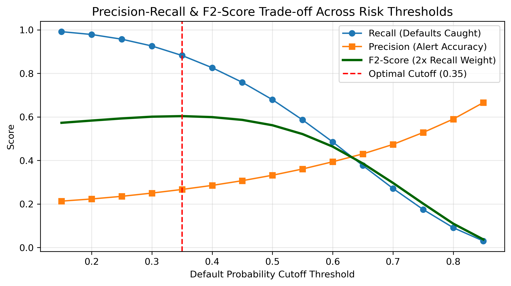
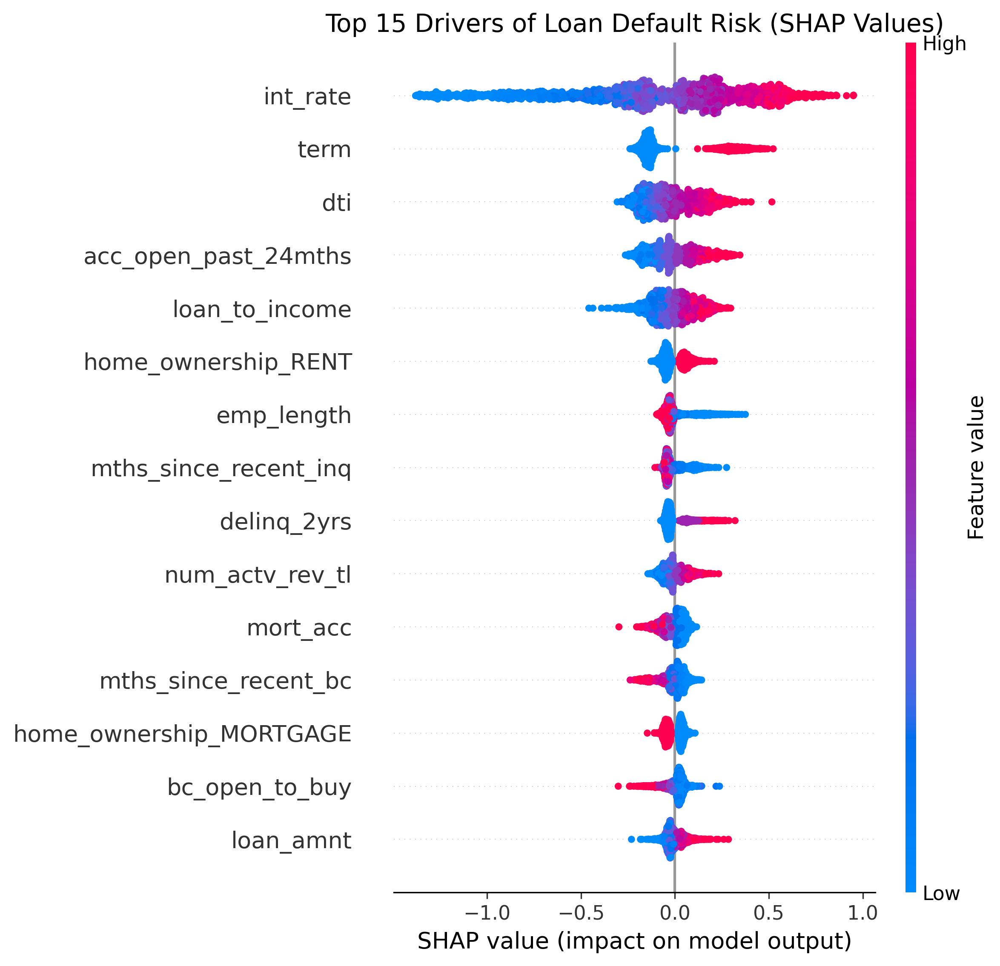

# Algorithmic Credit Risk & Loan Default Prediction Engine

An end-to-end machine learning pipeline built on **1.3 million+ historical LendingClub loan applications** to predict borrower default risk, optimize decision thresholds for asymmetric lending costs, and provide transparent regulatory explanations using **SHAP**.

## Business Problem & Approach
In consumer lending, failing to catch a loan default (losing principal) carries a significantly higher financial penalty than rejecting a borderline borrower. This project builds an auditable credit underwriting model that:
1. Prevents **data leakage** and **policy drift** through strict domain-driven data hygiene.
2. Handles **80/20 class imbalance** without synthetic oversampling memory overhead.
3. Tunes decision cutoffs using **F2-Score** to maximize default recall.
4. Explains both global portfolio risk drivers and individual applicant rejections via **SHAP**.

## Key Results
* **Dataset Scale:** 1,303,638 completed loans (`80% Paid` vs. `20% Default/Charged Off`), 172 engineered features.
* **Model Performance:** **0.4068 PR-AUC** (more than 2x the `0.2007` random baseline) and **0.7313 ROC-AUC**.
* **Threshold Optimization:** Shifting the probability threshold from `0.50` to **`0.35`** increased default recall from **67.94% to 88.25%** (`0.6038` F2-Score).

## Pipeline Architecture
1. **Data Hygiene & Leakage Prevention:** Filtered active/right-censored loans (`Current`, `Late`) and dropped post-origination columns (`recoveries`, `total_pymnt`, `last_pymnt_amnt`).
2. **Memory & Feature Engineering:** Downcasted numerical arrays to `float32` (cutting RAM usage by ~50%) and engineered domain ratios including `loan_to_income`, `installment_to_income`, and `credit_age_years`.
3. **Cost-Sensitive XGBoost:** Trained histogram-based gradient boosted trees with `scale_pos_weight = 3.98` across stratified 80/20 splits.
4. **Threshold Tuning (F2-Score):** Evaluated thresholds from `0.15` to `0.85` to balance alert precision against default recall without relying on arbitrary dollar assumptions.



5. **Regulatory Explainability (SHAP):** Identified top portfolio risk drivers (`int_rate`, `term`, `dti`, `acc_open_past_24mths`, `loan_to_income`) and generated individual waterfall audit charts.



## Tech Stack
* **Data Processing:** Python, Pandas, NumPy
* **Machine Learning:** XGBoost, Scikit-Learn
* **Explainability & Visualization:** SHAP, Matplotlib

## How to Run
1. Download the LendingClub Loan Dataset from Kaggle and place the CSV inside a `data/` directory.
2. Install dependencies:
   ```bash
   pip install pandas numpy scikit-learn xgboost shap matplotlib
   ```
3. Run `notebooks/credit_risk_pipeline.ipynb` sequentially.
